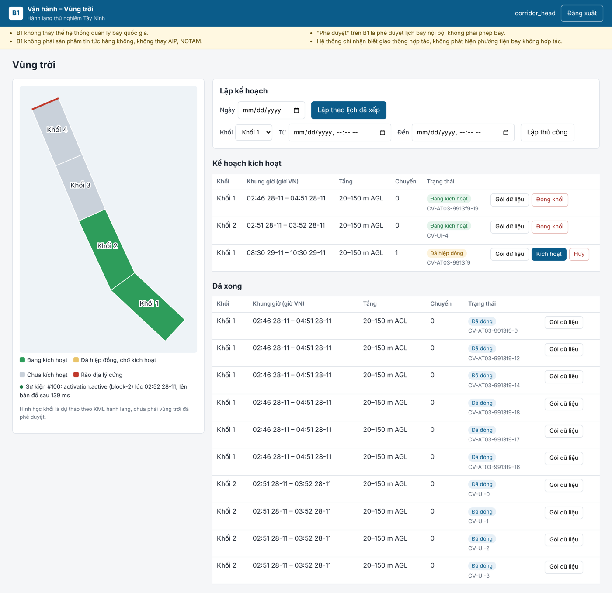
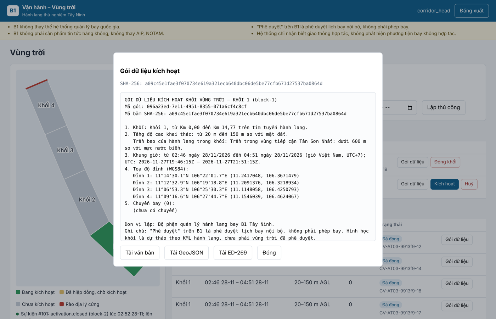

# Vùng trời và cho phép cất cánh (bước 3)

Theo Đặc tả B1 v0.1: F-03 (quản lý khối vùng trời), F-04 (cho phép cất cánh), Mục 2.2 (ràng buộc), Mục 4.4 (rào địa lý,
gói kích hoạt), AT-03. Mã: `b1/airspace`, `b1/operations`, `b1/signing.py`; trang vận hành `/ops/`.
Biên bản chạy trên bản sao số: [`acceptance/step3-at03.md`](acceptance/step3-at03.md).

## Dữ liệu vùng trời

- **Khối 1–4** nạp từ `config/corridor/blocks.geojson` khi khởi động (sinh bởi `tools/gen_corridor.py`, không sửa tay).
  Hình học là dự thảo theo KML hành lang v2.6.
- **Tầng khai thác** mỗi khối: mặc định 20–150 m so với mặt đất theo demo, vì D3 chưa chốt. Trưởng bộ phận sửa được qua
  `PATCH /v1/airspace/blocks/{id}/vertical`, có nhật ký; áp cho kế hoạch lập sau đó.
- **Trần bao** lấy từ ràng buộc: dưới 600 m so với mực nước biển đến Km 34,00; 1.000 m so với mặt đất sau đó. Khối 3 chạm cả hai.
- **Rào địa lý cứng Ranh Bắc khối 4**: thêm vào `constraints.geojson`, trùng đúng cạnh Bắc của khối 4.
- **Dải hạn chế 10 km tính từ biên giới**: có bản ghi ràng buộc nhưng chưa có hình học (`status: awaiting_data`), chờ dữ
  liệu đường biên giới chính thức. Mép hành lang cách biên giới khoảng 15,1 km nên dải này nằm ngoài hành lang hiện tại.
- Mặt nước hồ Dầu Tiếng nạp làm lớp tham chiếu.

## Kích hoạt khối

```
planned ──(ghi hiệp đồng, gắn mã băm gói)──▶ coordinated ──(kích hoạt)──▶ active ──(đóng)──▶ closed
   │                                            │
   └──(huỷ)──▶ cancelled        rejected ◀──────┘ (hiệp đồng không đồng ý)
```

1. **Lập kế hoạch**: `POST /v1/airspace/activations/plan` gom mọi chuyến đã xếp lịch trong một ngày theo (khối, khung giờ),
   mỗi nhóm một kế hoạch; hoặc lập thủ công một khối, một khung giờ. Không cho hai kế hoạch còn hiệu lực trùng giờ trên
   một khối. Kế hoạch chụp lại tầng độ cao và thông tin chuyến lúc lập.
2. **Gói dữ liệu** (`GET …/package?format=text|geojson|ed269|json`): mã khối, tầng, khung giờ, toạ độ đỉnh WGS84 (độ phút
   giây và thập phân), thông tin chuyến (số thứ tự, nhà khai thác, phương tiện, số đăng ký, mã nhận dạng, khối lượng, trong
   hay ngoài tầm nhìn). Ba dạng sinh từ một nội dung chuẩn, có cùng mã băm SHA-256 ở tiêu đề `X-Package-SHA256`.
   - Văn bản: đưa thẳng vào công văn hiệp đồng. Mẫu: [`acceptance/step3-at03-package.txt`](acceptance/step3-at03-package.txt).
   - GeoJSON: RFC 7946, vòng ngoài ngược chiều kim đồng hồ.
   - ED-269: theo cấu trúc công khai của mô hình UASZone; kiểm bằng `api/schemas/ed269-uaszone.schema.json`.
3. **Ghi hiệp đồng** (`POST …/coordination`): kết quả, số công văn, cơ quan, và mã băm của gói đã gửi. Gói đổi sau khi gửi
   thì mã băm không khớp và B1 từ chối, nên lần hiệp đồng luôn gắn với đúng bản đã gửi.
4. **Kích hoạt** chỉ sau hiệp đồng, sớm nhất 60 phút trước giờ bắt đầu, trước giờ kết thúc.
5. **Đóng** khi hạ cánh xong. B1 từ chối đóng khi còn chuyến đã được cho phép cất cánh hoặc đang bay trong khối.

Mọi thao tác chỉ dành cho Trưởng bộ phận có MFA, và đều ghi nhật ký, kể cả lần xuất gói.

### Trạng thái lên bản đồ ≤5 giây

Mỗi lần đổi trạng thái ghi một sự kiện vào `airspace.event` trong cùng giao dịch. Bản đồ đọc luồng Server-Sent Events
`GET /v1/airspace/stream`; luồng đọc bảng sự kiện mỗi 0,25 giây (`B1_AIRSPACE_POLL_S`). Cách này chạy được với nhiều tiến
trình B1, không cần hệ thống truyền bản tin riêng ở bước này. Đo trên bản sao số: trung vị khoảng 0,2 giây, lớn nhất
khoảng 0,3 giây từ lúc gửi lệnh đến lúc luồng nhận sự kiện. Trên trang vận hành bằng trình duyệt, khối đổi màu sau 0,2–0,3
giây (5 lần kích hoạt và 5 lần đóng, Playwright).

### Rào địa lý

`GET /v1/airspace/geofence` trả rào theo ranh khối đang kích hoạt (giữ trong, kèm sàn và trần) cộng rào cứng. Kết quả luôn
có `can_disable: false`: B1 không có API hay thông số nào tắt được rào. Giám sát tuân thủ dùng dữ liệu này ở bước 4.

## Cho phép cất cánh (F-04)

`POST /v1/flights/{id}/takeoff-clearance`, chỉ Cán bộ an toàn bay trực ban và Trưởng bộ phận, có MFA (AT-04). Thân yêu cầu
là danh mục kiểm tra 5 mục, mỗi mục `ok` kèm ghi chú, và `confirm: true`:

| Mục | Nội dung |
|---|---|
| `weather` | Thời tiết trong giới hạn của phương tiện trên đoạn tuyến và lớp độ cao |
| `ris_stations` | Trạm RIS trên tuyến hoạt động |
| `network` | Mạng, đường truyền dẫn và lớp lưu lượng an toàn sẵn sàng |
| `conformance_monitoring` | Giám sát tuân thủ của chuyến đang chạy |
| `emergency_plan` | Phương án khẩn nguy của chuyến đã sẵn sàng |

B1 tự kiểm thêm, thiếu điều kiện nào thì trả 409 kèm danh sách và ghi nhật ký `rejected`:

| Mã | Điều kiện |
|---|---|
| `WINDOW` | Trong khoảng từ 30 phút trước giờ bắt đầu đến trước giờ kết thúc của chuyến |
| `BLOCKS_ACTIVE` | Mọi khối của chuyến đang kích hoạt phủ trọn khung giờ của chuyến |
| `ON_DUTY` | Trưởng bộ phận có ca trực đang hiệu lực (Đặc tả Mục 1.1: "khi trực") |
| `CHECKLIST` | Đủ 5 mục đạt |
| `SIGNER_REAUTH` | Người ký đăng nhập lại trong 10 phút trước khi ký (claim `auth_time`) |

Hiện các mục thời tiết, trạm RIS, mạng, giám sát tuân thủ do người cho phép xác nhận. Từ bước 4, khi có dữ liệu trạm,
thời tiết và giám sát tuân thủ, B1 điền sẵn kết quả đo và chặn khi số đo không đạt.

### Ký điện tử

Khi đủ điều kiện, B1 lập bản ghi gồm chuyến, danh mục, kết quả từng điều kiện, người ký (vai trò, phương thức xác thực
`amr`, thời điểm đăng nhập), rồi ký bằng khoá ES256 của B1 (JWS). `GET /v1/flights/{id}/clearance` trả bản ghi, chữ ký và kết
quả tự kiểm; bên ngoài kiểm độc lập bằng khoá công khai ở `GET /v1/signing-keys`. Sửa bản ghi trong CSDL sau khi ký thì
`signature_valid` thành `false`.

Đây là chữ ký của hệ thống, gắn với người ký qua danh tính đã xác thực đa yếu tố và đăng nhập lại. Nếu quy chế cần chữ ký
số theo Luật Giao dịch điện tử (chứng thư số của tổ chức chứng thực), thay bước ký bằng ký phía người dùng (USB token hoặc
ký số từ xa) mà không đổi cấu trúc bản ghi. Khi vận hành, khoá của B1 nằm trong HSM hoặc kho bí mật (`B1_SIGNING_KEY_FILE`
chỉ dùng khi phát triển).

### Lịch trực

`POST /v1/duty/shifts` (Trưởng bộ phận), `GET /v1/duty/shifts?at=`, `POST /v1/duty/shifts/{id}/cancel`. Ca dài tối đa 24 giờ.
Vai trò phải có ca mới được cho phép cất cánh: `B1_DUTY_REQUIRED_ROLES`, mặc định chỉ `corridor_head`.

## Trang vận hành `/ops/`

Đăng nhập như cổng khách hàng (OIDC + PKCE, client `b1-portal`, thêm địa chỉ chuyển hướng `/ops/*`). Bản đồ vẽ bằng SVG từ
hình học khối, không cần nền bản đồ ngoài nên chạy được trong mạng vận hành kín; khối tô màu theo trạng thái, cập nhật
theo luồng sự kiện. Trưởng bộ phận có MFA lập kế hoạch, xem và tải gói, ghi hiệp đồng, kích hoạt, đóng, huỷ; vai trò khác
chỉ xem.





## Chuyến của bản sao số

Quy trình xếp lịch chỉ nhận khung từ ngày mai, nên để thử cho phép cất cánh và bay ngay trên bản sao số có lệnh
`B1_ALLOW_TWIN_TOOLS=1 python -m b1.admin twin-flight …` tạo một chuyến bắt đầu sau vài phút. Thiếu biến môi trường thì lệnh
không chạy; mỗi lần dùng ghi nhật ký `twin.flight.inject`.

## Việc còn mở

1. **D3 tầng độ cao từng khối**: đang dùng 20–150 m so với mặt đất.
2. **I-05 hiệp đồng với cơ quan điều hành bay**: chưa có quy chế; đang ghi tay số công văn. Gói đã ở dạng máy đọc được,
   nên khi có API chỉ đổi kênh gửi.
3. **ED-269**: lược đồ kiểm tra viết theo cấu trúc công khai, cần đối chiếu văn bản chuẩn khi có (giống D7 với ASTM).
4. **Dải 10 km tính từ biên giới**: cần dữ liệu đường biên giới chính thức.
5. **Ý định bay F3548 qua DSS cho khối đã kích hoạt** (Mục 4.4): làm cùng USS hành lang khi nối telemetry và giám sát tuân
   thủ ở bước 4.
6. **Tự đóng khối** khi hết khung giờ và không còn chuyến: cần trạng thái hạ cánh từ bước 4; hiện đóng tay.
