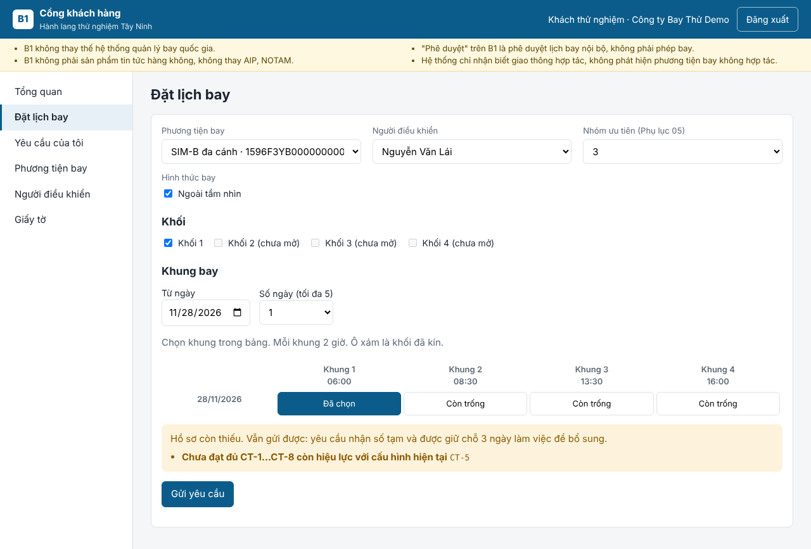
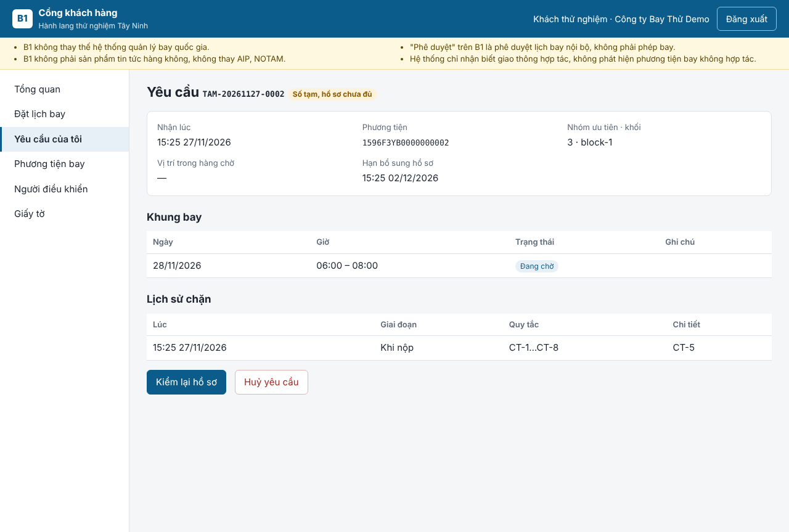

# Cổng khách hàng (bước 2d)

Giao diện web cho khách hàng (nhà khai thác bay, bộ phận đào tạo) tại `/portal/`. Mã: `b1/portal`.

## Khách hàng làm được gì

- **Đặt lịch bay:** chọn phương tiện, người điều khiển, nhóm ưu tiên, khối đang mở, ngày và khung. Bảng khung hiện khối
  còn trống và số yêu cầu đang chờ. Trước khi gửi, cổng **xem trước điều kiện hồ sơ** và nói rõ thiếu gì; vẫn gửi được,
  khi đó nhận số tạm và giữ chỗ 3 ngày làm việc.
- **Theo dõi yêu cầu:** số thứ tự, vị trí trong hàng chờ, trạng thái từng khung, lý do không xếp được, lịch sử chặn;
  kiểm lại hồ sơ sau khi bổ sung; huỷ yêu cầu.
- **Hồ sơ:** khai phương tiện (kèm tra số đăng ký qua I-02), người điều khiển; nộp giấy tờ và xem trạng thái xác nhận.
- **Thông báo:** đã nhận yêu cầu, hồ sơ chưa đủ, đã xếp hoặc không xếp được, huỷ ở lần xác nhận cuối, nhắc lịch
  T − 7, T − 3, T − 1. Hiện trên cổng; kênh thư điện tử, tin nhắn thêm sau qua mô-đun kết nối.
- Bốn tuyên bố cố định của Đặc tả Mục 1 luôn hiện ở đầu trang, không tắt được.

## Đăng nhập

OIDC Authorization Code + PKCE ngay trên trình duyệt với client công khai `b1-portal`; không có mật khẩu nào đi qua B1.
Môi trường phát triển dùng Keycloak (realm trong `config/keycloak/realm-b1.json`, có 3 tài khoản thử). Đổi sang I-08
của tỉnh bằng cấu hình `B1_OIDC_ISSUER`, `B1_JWKS_URL`, `B1_PORTAL_CLIENT_ID`. Tài khoản phải được cấp trong B1 và gắn
với hồ sơ khách hàng thì mới vào được.

## Việc còn mở

1. **Xác thực đa yếu tố trên Keycloak:** realm phát triển chưa bật OTP nên token không có `amr`; thao tác đặc quyền của
   cán bộ (xác nhận giấy tờ, chạy xếp lịch, cho phép cất cánh) vì vậy bị từ chối khi đăng nhập qua Keycloak phát triển.
   Cần cấu hình luồng đăng nhập có OTP và giá trị `amr` trước khi làm giao diện điều hành ở bước 3.
2. **Tải tệp giấy tờ:** chờ kho tệp có mã hoá (bước 6).
3. **Giao diện cho cán bộ:** bước 3 có trang vận hành `/ops/` cho vùng trời (`docs/airspace-and-clearance.md`). Xác nhận giấy tờ,
   chạy xếp lịch, cho phép cất cánh trên giao diện làm cùng giao diện điều hành ở bước 4; hiện qua API.
