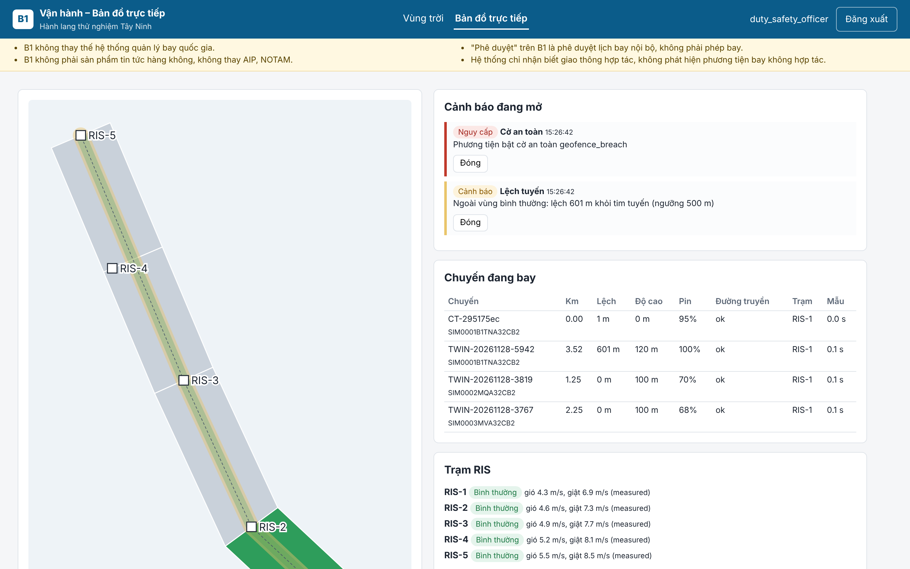

# Telemetry, dữ liệu trạm, giám sát tuân thủ và cảnh báo (bước 4)

Theo Đặc tả B1 v0.1: F-05 (giám sát thời gian thực), F-06 (cảnh báo, giám sát tuân thủ), Mục 3.2 lớp L1–L5, Mục 4.5
(phân bổ độ trễ, gộp vết, vết cũ), Mục 5 (Remote ID, telemetry, CT-1…8), Mục 8.4 (mức suy giảm). Mã: `b1/telemetry`,
`b1/surveillance`, `b1/monitoring`, `b1/geo.py`; trang `/ops/live`. Biên bản chạy trên bản sao số:
[`acceptance/step4.md`](acceptance/step4.md).

```
khách ──I-07 HTTPS / MQTT 5 / MAVLink v2──▶ cổng telemetry ──▶ telemetry.sample ──▶ quy tắc (L5) ──▶ monitoring.alert
trạm RIS ──I-06──▶ thu dữ liệu trạm ──▶ surveillance.record ─┬─▶ gộp vết ADS-B, vết Remote ID     │   + monitoring.event
                                                             └─▶ đối chiếu Remote ID ─────────────┘         │
                                                                         bản đồ trực tiếp ◀── SSE /v1/live/stream
```

## Cổng telemetry I-07

Hợp đồng: [`api/i07-telemetry.openapi.yaml`](../api/i07-telemetry.openapi.yaml). Ba kênh cùng một đường xử lý
(`TelemetryService.ingest`), nên cùng quy tắc kiểm:

| Kênh | Cách vào | Xác thực |
|---|---|---|
| HTTPS theo lô ≤ 1 giây | `POST /telemetry/v1/flights/{id}/samples`, gửi bù `…/backfill` | Token OAuth 2.0 có phạm vi `telemetry:write`, đúng khách sở hữu chuyến |
| MQTT 5 | Chủ đề `b1/v1/telemetry/{flightId}`, QoS 1, tải là một mẫu hoặc `{"samples": [...]}` | Máy chủ MQTT xác thực chứng chỉ khách và giới hạn chủ đề (ACL); B1 đăng ký `b1/v1/telemetry/+` |
| MAVLink v2 trên UDP | Cổng `B1_MAVLINK_UDP_PORT`; gán sysid vào chuyến bằng `POST /telemetry/v1/flights/{id}/mavlink` | Ký bản tin MAVLink v2 (khoá 32 byte do khách khai khi gán) |

Mỗi mẫu đi qua:

1. **Lược đồ**: kiểm bằng chính `TelemetrySample` trong hợp đồng I-07 (một nguồn sự thật). Mẫu sai bị loại riêng lẻ, mẫu
   đúng trong cùng lô vẫn được nhận; lý do ghi vào `telemetry.rejected`, khách xem ở `GET …/rejected`.
2. **Đúng chuyến**: `flightId` trùng đường dẫn, `uasId` trùng UAS ID của chuyến (AT-14: bản tin của chuyến khác bị từ chối).
3. **Giờ nguồn**: sớm hơn giờ B1 quá 5 giây là đồng hồ nguồn chưa đồng bộ, bị loại.
4. **Trạng thái chuyến**: chưa được cho phép cất cánh trả 403; chuyến đã hạ cánh chỉ nhận gửi bù (409 với kênh thời gian thực).
5. **Khử trùng** theo (`flightId`, `uasId`, `timeSource`): gửi lại, gửi bù trùng không tạo bản ghi mới (`duplicates` trong phản hồi).
6. **Hạn mức gửi bù** riêng từng chuyến: 1000 mẫu/giây, xô 2000 mẫu (`B1_BACKFILL_RATE_PER_S`, `B1_BACKFILL_BURST`). Vượt thì 429 kèm `Retry-After`, bộ phát chờ rồi gửi lại lô đó. Mẫu thời gian thực không chịu hạn mức này, nên gửi bù dồn dập không làm trễ cảnh báo. Lần chạy đầu trên bản sao số chưa có hạn mức: bốn luồng gửi bù liên tục đã làm mẫu thời gian thực của phiên CT tới trễ tới 19 phút và đẩy độ trễ ghi của các chuyến khác lên 25 giây.
6. **Ba nhãn thời gian** (D6): `t_source` (nguồn), `t_receive` (B1 nhận), `t_ingest` (ghi vào CSDL, đồng hồ máy chủ CSDL).
7. **Độ cao**: lưu nguyên giá trị và hệ quy chiếu, kèm độ cao so với mặt đất và so với mực nước biển suy ra. Phương tiện không
   gửi `agl` thì B1 dùng độ cao địa hình một giá trị cho cả hành lang (`B1_TERRAIN_ELEV_M`, mặc định 25 m) và độ cao geoid
   (`B1_GEOID_UNDULATION_M`, mặc định 0). Cần mô hình số độ cao và mô hình geoid trước khi bay thật (việc còn mở 1).
8. **Trạng thái chuyến theo telemetry**: `cleared → airborne` ở mẫu armed đầu tiên; `airborne → landed` khi disarmed liên
   tục 10 giây theo giờ nguồn.

MAVLink: bộ giải mã tự viết cho HEARTBEAT, SYS_STATUS, SYSTEM_TIME, GPS_RAW_INT, GLOBAL_POSITION_INT, VFR_HUD,
BATTERY_STATUS, không dùng pymavlink (LGPL). Kiểm thử đối chiếu từng byte với khung do pymavlink 2.4.50 sinh, kể cả chữ ký
(`tests/data/mavlink_pymavlink_frames.json`). Có khoá ký thì bản tin không ký, sai chữ ký hoặc có nhãn thời gian ký không
tăng (phát lại) đều bị bỏ. Chế độ bay đọc theo ArduCopter; chế độ RTL bật cờ `failsafe_rtl`, trạng thái CRITICAL hoặc
EMERGENCY bật cờ `emergency`. Phía phương tiện không báo được mất đường truyền điều khiển qua MAVLink telemetry, nên
`c2Link.state` của kênh này luôn `ok`; B1 dựa vào cảnh báo mất telemetry.

TLS 1.3 và chứng chỉ hai chiều nằm ở cổng vào (mẫu cấu hình [`config/ingress/telemetry-nginx.conf`](../config/ingress/telemetry-nginx.conf)).
Cổng vào gắn kết quả vào tiêu đề `X-B1-TLS-Version`, `X-B1-Client-Verify`, `X-B1-Client-Subject` và xoá tiêu đề cùng tên do
khách gửi; B1 dùng các tiêu đề này để chấm CT-6. Vì vậy khi vận hành, cổng telemetry của B1 chỉ được mở cho cổng vào, không
mở thẳng ra ngoài.

## Dữ liệu trạm RIS (I-06)

`POST /ris/v1/stations/{RIS-n}/records` (gửi bù và thử nghiệm; kênh chính là hệ thống truyền bản tin theo D2). Trạm là tài
khoản máy có vai trò `ris_station`, token mang claim `station_id` đúng trạm. Năm loại bản ghi kiểm theo lược đồ I-06 rồi lưu
vào `surveillance.record` với ba nhãn thời gian (nguồn, trạm theo PTP, ghi vào CSDL).

- **Gộp vết ADS-B** (Mục 4.5): khoá theo ICAO 24 bit, cửa sổ 200 ms. Nhiều trạm thu cùng bản tin thì giữ bản có tín hiệu
  tốt nhất và lưu danh sách trạm đã thu; bản tin cũ đến muộn bị bỏ.
- **Vết cũ**: quá 15 giây là `degraded`, vòng bất định = tốc độ × tuổi vết; quá 30 giây bỏ khỏi bản đồ, bản ghi gốc vẫn giữ.
- **Trạng thái trạm**: mất bản tin trạng thái quá 5 giây là L2 (cảnh báo nguy cấp); chạy 4G/5G là L1, chạy bộ lưu điện là L4
  (cảnh báo). Thời tiết đo gần nhất của từng trạm hiện trên bản đồ, kèm nhãn số đo, nội suy, ngoại suy, dự báo.

### Đối chiếu Remote ID với telemetry

Mỗi bản tin Broadcast Remote ID của một UAS ID thuộc chuyến đã cho phép cất cánh hoặc đang bay được so với mẫu telemetry
gần nhất cùng thời điểm (±1 giây). Lệch quá 100 m là "không khớp" và sinh cảnh báo `RID_MISMATCH` (để phát hiện Remote ID
giả); ba lần khớp liên tiếp thì tự giải toả. Bản tin Remote ID tới trước mẫu telemetry cùng thời điểm được giữ lại tối đa
2 giây chờ mẫu đó. Tỷ lệ khớp từng chuyến, theo từng trạm: `GET /v1/surveillance/flights/{id}/rid-reconciliation` (AT-05).
Remote ID không thuộc chuyến nào mà nằm trong hành lang sinh cảnh báo `RID_UNKNOWN`.

## Trục thời gian 10 Hz

`GET /v1/flights/{id}/timeline?hz=10` đặt mẫu lên lưới đều. Mốc có mẫu cách ≤ nửa bước lưới là `measured`; hai mẫu kẹp
cách nhau ≤ 1 giây thì nội suy tuyến tính, nhãn `interpolated`; khoảng trống dài hơn là `gap`, không bịa vị trí. Phát lại
(bước 6) dùng trục này.

## Giám sát tuân thủ và cảnh báo

Mỗi mẫu thời gian thực qua bộ quy tắc ngay trong lượt nhận (`b1/monitoring/rules.py`, hàm thuần). Ngưỡng là giá trị demo
D6, chờ phương án an toàn được duyệt; đổi bằng biến môi trường, không sửa mã.

| Loại | Điều kiện | Cấp |
|---|---|---|
| `LATERAL_DEVIATION` | Lệch tim tuyến > 500 m (ngoài vùng bình thường) | cảnh báo |
| | > 750 m (vào vùng dự phòng): chuyến không tuân thủ | nguy cấp |
| `BOUNDARY` | Ra ngoài ranh khối đang kích hoạt của chuyến, hoặc khối chưa kích hoạt; ghi rào cứng gần đó nếu có | nguy cấp |
| `CEILING` | Trên trần của kế hoạch kích hoạt (150 m so với mặt đất), hoặc trần bao của hành lang theo đoạn Km | nguy cấp |
| `C2_LINK` | Đường truyền điều khiển phía phương tiện suy giảm / mất | cảnh báo / nguy cấp |
| `LOW_BATTERY` | Pin hoặc nhiên liệu < 25% / < 15% | cảnh báo / nguy cấp |
| `SAFETY_FLAG` | Mỗi cờ an toàn đang bật (c2_lost, geofence_breach, emergency, failsafe_land: nguy cấp) | theo cờ |
| `TELEMETRY_STALE` | Chuyến đang bay không có mẫu quá 2 giây | nguy cấp |
| `TRAFFIC` | Vết ADS-B cách chuyến đang bay < 2 km ngang và < 300 m đứng | nguy cấp |
| `RID_MISMATCH`, `RID_UNKNOWN` | Xem phần đối chiếu Remote ID | cảnh báo |
| `STATION` | Trạm L1, L4 (cảnh báo), L2 (nguy cấp) | theo mức |
| `HANDOVER` | Chuyến chuyển sang vùng phủ của trạm khác | thông tin |

- **Khử trùng, nâng cấp, tự giải toả**: một cảnh báo cho mỗi (chuyến, loại, chủ thể) đang mở; nặng lên thì nâng cấp trên cùng
  cảnh báo (`alert.escalated`); hết điều kiện ở mẫu sau thì tự giải toả (`resolved_by: auto`).
- **Xác nhận**: `POST /v1/alerts/{id}/acknowledge` (Cán bộ an toàn bay trực ban, Trưởng bộ phận, có MFA), `resolve: true` để
  đóng; ghi nhật ký. Điều kiện còn thì mẫu sau mở cảnh báo mới.
- **Hình học**: chiếu phẳng cục bộ theo bán kính cong ellipsoid WGS84 (`b1/geo.py`), không cần PostGIS khi chạy. Khoảng cách
  tới tim tuyến khớp đường trắc địa của pyproj trong 0,1 m.
- **Phiên kiểm tra CT** tại khu thử chỉ áp quy tắc đường truyền, năng lượng, cờ an toàn (không lệch tuyến, vượt ranh).
- Thứ tự xử lý sau cảnh báo (ngắt động cơ, quay về, hạ cánh khẩn cấp) và lệnh dừng thuộc bước 5 (F-07).

Mỗi thay đổi cảnh báo ghi một sự kiện vào `monitoring.event` trong cùng giao dịch. Cảnh báo mang `t_source` và `t_receive`
của mẫu gây ra nó, nên độ trễ đo được ở mọi khâu.

### Độ trễ cảnh báo

Mục tiêu ≤ 2,0 giây ở phân vị 95 (Mục 4.5, AT-06). Cảnh báo phát ngay trong lượt nhận mẫu; luồng bản đồ đọc hộp thư đi mỗi
0,1 giây (`B1_ALERT_POLL_S`). Kết quả trên bản sao số ở biên bản bước 4.

## Bản đồ trực tiếp `/ops/live`

Đăng nhập như trang vận hành. SVG vẽ từ hình học khối: tim tuyến, vùng bình thường ±500 m, vùng dự phòng ±750 m, 5 trạm tô
theo mức suy giảm, chuyến đang bay (mũi tên theo hướng bay, đỏ khi không tuân thủ hoặc có cảnh báo nguy cấp, xám khi mất
telemetry), vết ADS-B (đứt nét kèm vòng bất định khi cũ), Remote ID lạ. Bên phải: cảnh báo đang mở (xác nhận, đóng), bảng
chuyến (Km, lệch, độ cao, pin, đường truyền, trạm đang phủ, tuổi mẫu), trạng thái và thời tiết trạm. Dữ liệu qua SSE
`GET /v1/live/stream`: cảnh báo đến ngay, ảnh chụp vị trí 5 lần mỗi giây.



## Kiểm tra tuân thủ dữ liệu CT-1…8

Khách mở phiên (`POST /v1/ct-sessions`), gửi telemetry tới mã phiên như gửi cho một chuyến, đánh dấu đoạn thử
(`POST …/marks`: `static_start/end`, `load_start/end`, `disconnect_start/end`), rồi chấm (`POST …/evaluate`). Phiên khách tự
mở cho kết quả tham khảo; phiên do Kỹ thuật viên bay thử mở (`official: true`, tối thiểu 30 phút) ghi kết quả vào hồ sơ
phương tiện, có hiệu lực 12 tháng như ghi tay. Bộ phát tham khảo cho khách: [`tools/ct_client.py`](../tools/ct_client.py).

| Bài | B1 chấm |
|---|---|
| CT-1 | Phát lại ≥ 30 phút, không mẫu nào bị loại vì sai lược đồ |
| CT-2 | ≥ 5 Hz, ≥ 99% khoảng cách ≤ 300 ms, không khoảng > 2 giây (trừ đoạn ngắt có chủ đích, sau gửi bù) |
| CT-3 | Giờ nguồn tăng liên tục theo thứ tự đến; trung vị (giờ B1 nhận − giờ nguồn) ≤ 200 ms. Đồng hồ B1 phải theo NTP/PTP của hành lang |
| CT-4 | Đứng yên tại điểm RTK khai khi mở phiên ≥ 10 phút: ≥ 95% mẫu trong 5 m |
| CT-5 | Cờ c2_lost và geofence_breach đều xuất hiện; mỗi lần bật cờ thành cảnh báo ≤ 2 giây sau giờ nguồn |
| CT-6 | TLS 1.3 và chứng chỉ khách hợp lệ (tiêu đề của cổng vào); không qua cổng vào thì Kỹ thuật viên xác nhận bằng biên bản |
| CT-7 | Trong đoạn chạy tải: vẫn ≥ 5 Hz, ≥ 99% khoảng ≤ 300 ms, không khoảng > 2 giây, xét cả theo nhãn nguồn lẫn theo giờ B1 nhận (bộ phát nghẽn vẫn đặt nhãn nguồn đều nhưng mẫu tới dồn cục) |
| CT-8 | Sau đoạn ngắt ~60 giây: mẫu thời gian thực đầu tiên ≤ 10 giây; gửi bù lấp đoạn ngắt với nhãn gốc, khoảng lớn nhất ≤ 1 giây |

CT-5 hiện do khách tự tạo tình huống. Khi có dịch vụ thử F-15 tại khu thử RIS-1 thì dịch vụ đó tạo tình huống (Mục 5.3).

## Cấu hình

| Biến | Mặc định | Ý nghĩa |
|---|---|---|
| `B1_MAVLINK_UDP_PORT`, `B1_MAVLINK_UDP_HOST` | trống, `0.0.0.0` | Mở cổng MAVLink v2 |
| `B1_MQTT_URL` (+ `_CA_FILE`, `_CERT_FILE`, `_KEY_FILE`) | trống | Nối cầu MQTT 5 (`mqtt://` hoặc `mqtts://`) |
| `B1_NORMAL_HALF_WIDTH_M`, `B1_CONTINGENCY_HALF_WIDTH_M` | 500, 750 | Ngưỡng lệch tuyến (D6) |
| `B1_BATTERY_WARN_PCT`, `B1_BATTERY_CRIT_PCT` | 25, 15 | Ngưỡng năng lượng |
| `B1_TELEMETRY_STALE_S` | 2 | Mất telemetry |
| `B1_RID_MISMATCH_M` | 100 | Ngưỡng đối chiếu Remote ID |
| `B1_TRAFFIC_HORIZONTAL_M`, `B1_TRAFFIC_VERTICAL_M` | 2000, 300 | Giao thông có người lái |
| `B1_TERRAIN_ELEV_M`, `B1_GEOID_UNDULATION_M` | 25, 0 | Đổi hệ quy chiếu độ cao (tạm) |
| `B1_MONITOR_BACKGROUND` | true | Vòng kiểm 0,5 giây trong tiến trình API |

## Việc còn mở

1. **Mô hình số độ cao và geoid**: đang dùng một độ cao địa hình cho cả hành lang. Cần trước khi kiểm trần theo mực nước
   biển với phương tiện chỉ gửi độ cao so với mặt đất, và trước khi lưu độ cao theo ellipsoid như Mục 5.1.
2. **D6 ngưỡng vùng bình thường, vùng dự phòng, vòng cảnh báo theo chuyến** (từ tốc độ và khối lượng khách khai): đang dùng
   500 m, 750 m và 2 km cố định.
3. **Rủi ro thời tiết theo giới hạn từng phương tiện** (được bay, thận trọng, không bay) và điền sẵn danh mục F-04 từ số đo:
   đã có số đo trạm; cần giới hạn thời tiết của phương tiện trong hồ sơ.
4. **Network Remote ID F3411 và ý định bay F3548 qua USS hành lang**: làm cùng bước nối USS (đã có PoC ở bước 1).
5. **Nhiều tiến trình nhận telemetry**: trạng thái trực tiếp (vị trí mới nhất, vết) đang ở bộ nhớ một tiến trình; cảnh báo,
   sự kiện đã ở CSDL. Khi tách tiến trình, gán chuyến theo mã chuyến hoặc chuyển trạng thái này sang kho dùng chung (bước 7).
6. **Hệ thống truyền bản tin cho I-06 (D2)**: trạm đang gửi qua HTTPS; khi chốt D2 thì thêm bộ chuyển đổi như cầu MQTT.
